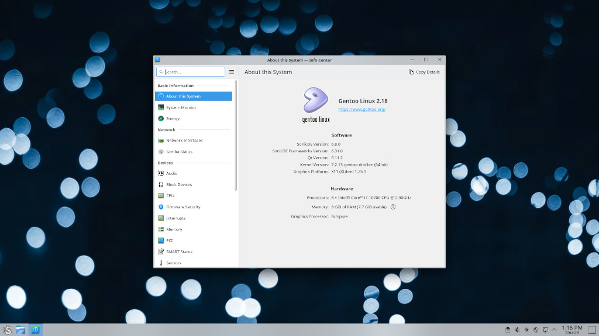

# SonicDE Packages for Gentoo Linux Systems

This third-party repository provides [SonicDE](https://sonicde.org) ebuilds for [Gentoo Linux](https://gentoo.org). SonicDE, or the Sonic Desktop Environment, aims to preserve and improve the X11-specific aspects of KDE. You can learn more about SonicDE at [sonicde.org](https://sonicde.org/).

## Adding

Put the following in `/etc/portage/repos.conf/sonicde.conf`:

```conf
[sonicde]
location = /var/db/repos/sonicde
sync-type = git
sync-uri = https://github.com/sonicde-gentoo/sonicde-gentoo
```

Then sync:

```
# emaint sync -r sonicde
```

Now, accept unstable keywords for all packages in the `sonicde`
overlay. In `/etc/portage/package.accept_keywords/00-sonicde`:

```
*/*::sonicde
```

Then emerge `sonicde-base/sonicde-meta` to install the desktop.

## Installing applications

Use `emerge --ask sonicde-base/sonicde-core-meta` to install the core
applications, including Ecco and Sonic Terminal. The
`sonicde-base/sonicde-apps-meta` package also selects application groups through
USE flags. You can emerge individual groups such as
`sonicde-base/sonicde-graphics-meta` or `sonicde-base/sonicde-utils-meta` directly.

## Using newer Plasma

The latest Plasma with unstable keywords can also be used with SonicDE.
The KDE overlay provides a package.accept_keywords file to unmask the
necessary KDE packages:

https://gitweb.gentoo.org/proj/kde.git/tree/Documentation/package.accept_keywords

Copy or symlink the `kde-plasma-6.7.keywords` file into
`/etc/portage/package.accept_keywords`.  It's not necessary to use any
ebuilds from the KDE overlay.

## Getting in Contact

Please report any enhancement requests or issues with this repository at [Issues · sonicde-gentoo/sonicde-gentoo](https://github.com/sonicde-gentoo/sonicde-gentoo/issues). In case you need help, want to report success, or talk about other aspects, please also check the official SonicDE channels.

&nbsp;[Bluesky](https://bsky.app/profile/sonicdesktop.bsky.social)&nbsp; &nbsp;[Discord](https://discord.gg/cNZMQ62u5S) &nbsp; &nbsp;[Mastodon](https://mastodon.social/@sonicdesktop) &nbsp; &nbsp;[Matrix](https://matrix.to/#/#sonicdesktop:matrix.org) &nbsp; &nbsp;[OFTC IRC](https://webchat.oftc.net/?channels=sonicde%2Csonicde-devel%2Csonicde-dist&uio=MT11bmRlZmluZWQb1) &nbsp; &nbsp;[Telegram](https://t.me/sonic_de) &nbsp; &nbsp;[X (Twitter)](https://x.com/SonicDesktop)
